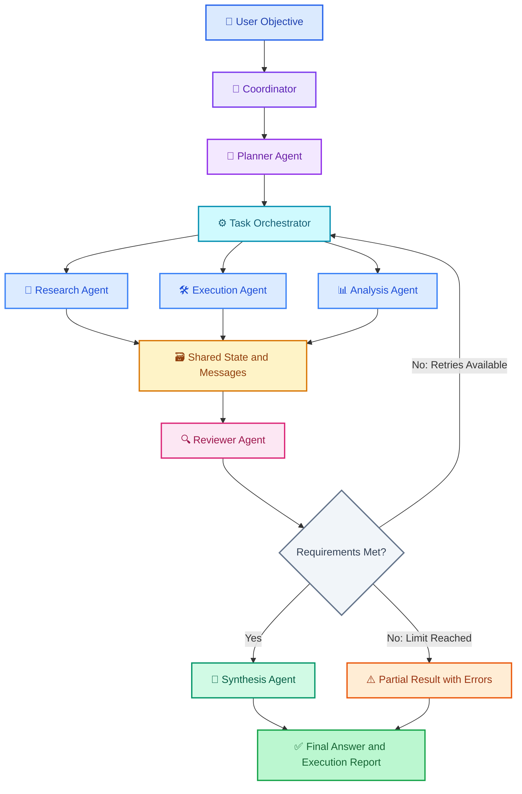
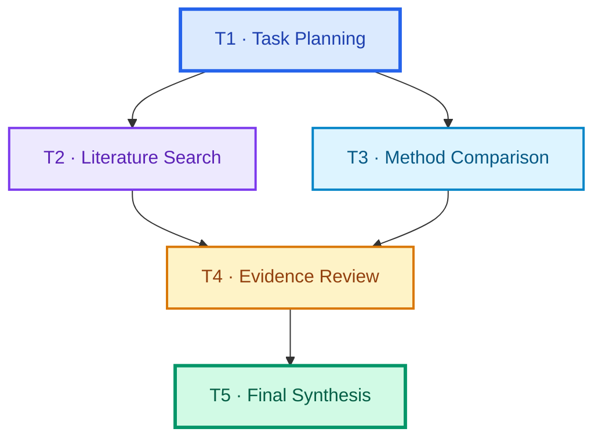

<div align="center">

# AgentCrew-AI

### A Collaborative Multi-Agent AI Framework for Autonomous Task Execution

**Intelligent Planning · Multi-Agent Collaboration · Task Orchestration · Tool Execution · Verification**

[](https://www.python.org/)
[](https://github.com/topics/multi-agent-systems)
[](https://github.com/topics/large-language-models)
[](https://github.com/topics/agentic-ai)
[](https://github.com/Miraj-Rahman-AI/Adv-AI-Agents/tree/main/AgentCrew-AI)

**Part of [Adv-AI-Agents](https://github.com/Miraj-Rahman-AI/Adv-AI-Agents)**

</div>

---

## Table of Contents

1. [Overview](#1-overview)
2. [Project Objectives](#2-project-objectives)
3. [Key Features](#3-key-features)
4. [System Architecture](#4-system-architecture)
5. [Specialized Agent Roles](#5-specialized-agent-roles)
6. [Task Dependency Graph](#6-task-dependency-graph)
7. [Multi-Agent Execution Workflow](#7-multi-agent-execution-workflow)
8. [Core Framework Components](#8-core-framework-components)
9. [Inter-Agent Communication and Shared Memory](#9-inter-agent-communication-and-shared-memory)
10. [LLM Integration](#10-llm-integration)
11. [Tool Integration and Execution](#11-tool-integration-and-execution)
12. [Security and Authorization](#12-security-and-authorization)
13. [Reliability and Failure Recovery](#13-reliability-and-failure-recovery)
14. [Technology Stack](#14-technology-stack)
15. [Project Structure](#15-project-structure)
16. [Example Use Case](#16-example-use-case)
17. [Installation and Configuration](#17-installation-and-configuration)
18. [Testing and Validation](#18-testing-and-validation)
19. [Evaluation Framework](#19-evaluation-framework)
20. [Development Roadmap](#20-development-roadmap)
21. [Research Directions](#21-research-directions)
22. [Contributing](#22-contributing)
23. [License](#23-license)
24. [Maintainer](#24-maintainer)

---

## 1. Overview

**AgentCrew-AI** is a research-oriented, modular multi-agent framework designed to coordinate specialized Large Language Model (LLM)-based agents for collaborative problem-solving and autonomous task execution.

The framework aims to transform a high-level user objective into a structured workflow of smaller tasks. Specialized agents then collaborate through coordinated execution, shared state, structured communication, and result verification.

Rather than relying on a single LLM agent to perform every operation, AgentCrew-AI separates responsibilities across multiple specialized roles.

The proposed system supports:

- Autonomous task planning and decomposition.
- Specialized agent collaboration.
- Dependency-aware workflow orchestration.
- Structured inter-agent communication.
- Shared task context and memory.
- Permission-controlled tool execution.
- Result validation and verification.
- Failure detection and recovery.
- Execution tracing and performance evaluation.

### Project Vision

The long-term objective is to develop a flexible multi-agent framework capable of addressing complex, knowledge-intensive tasks while supporting systematic research into agent coordination, efficiency, reliability, and security.

### Current Development Status

> **Status: Research and Development**
>
> The repository currently contains the project README, Python package configuration, environment template, and initial Python package scaffold.
>
> The architecture, workflows, agent roles, tools, and evaluation capabilities described in this document represent the intended implementation.
>
> These capabilities should not be interpreted as implemented or experimentally validated until the corresponding source code and tests are available.

### Potential Applications

| Application | Description |
|---|---|
| Academic Research | Literature discovery, analysis, comparison, and synthesis |
| Software Engineering | Multi-agent programming and code review workflows |
| Data Analysis | Coordinated data processing and interpretation |
| Enterprise Automation | Multi-step business workflow execution |
| Information Retrieval | Collaborative retrieval and knowledge synthesis |
| Agent Security Research | Authorization, delegation, and tool-use evaluation |

---

## 2. Project Objectives

AgentCrew-AI aims to investigate and implement coordinated task execution using specialized LLM-based agents.

### Primary Objectives

**1. Collaborative Problem-Solving**

Enable multiple specialized agents to jointly complete objectives that require different capabilities.

**2. Intelligent Task Decomposition**

Translate high-level instructions into structured subtasks with explicit dependencies and success conditions.

**3. Specialized Agent Responsibilities**

Assign tasks to agents based on their capabilities, responsibilities, and permitted tools.

**4. Dependency-Aware Orchestration**

Manage task execution order, parallelism, scheduling, and completion states.

**5. Inter-Agent Communication**

Enable agents to exchange structured findings, task results, and relevant execution context.

**6. Shared Context Management**

Maintain task information and intermediate results without requiring every agent to access the entire interaction history.

**7. Controlled Tool Execution**

Provide agents with access to approved external tools and APIs under explicit authorization constraints.

**8. Result Verification**

Validate task outputs and check whether the overall objective has been satisfied.

**9. Reliability and Recovery**

Handle execution failures, timeouts, invalid outputs, and bounded retries.

**10. Reproducible Evaluation**

Measure task success, efficiency, collaboration quality, and security using repeatable experiments.

---

## 3. Key Features

The following capabilities define the intended development scope.

| Feature | Description | Status |
|---|---|---|
| Multi-Agent Collaboration | Coordination of specialized agents | Planned |
| Intelligent Task Planning | LLM-based task decomposition | Planned |
| Role-Based Agents | Specialized agent interfaces | Planned |
| Workflow Orchestration | Scheduling and dependency management | Planned |
| Shared Context | Common task state and intermediate results | Planned |
| Inter-Agent Communication | Structured agent messages | Planned |
| LLM Integration | Hosted and local language models | Planned |
| Tool Integration | Controlled APIs and tool execution | Planned |
| Result Verification | Output validation and review | Planned |
| Failure Recovery | Timeouts, retries, and error propagation | Planned |
| Security Policies | Task authorization and tool permissions | Planned |
| Execution Tracing | Logs, task states, and model usage | Planned |
| Performance Evaluation | Quality, reliability, latency, and cost | Planned |

---

## 4. System Architecture

AgentCrew-AI follows a modular architecture that separates objective interpretation, planning, orchestration, agent execution, shared state, verification, and result synthesis.

### 4.1 Proposed Architecture



**Figure 1. Proposed AgentCrew-AI multi-agent architecture.**

The architecture illustrates how a user objective is transformed into a coordinated workflow involving specialized agents, shared state, and verification.

### 4.2 Architectural Layers

| Layer | Components | Responsibilities |
|---|---|---|
| Input Layer | User Interface, CLI | Receive objectives and constraints |
| Coordination Layer | Coordinator | Manage overall execution |
| Planning Layer | Planner Agent | Generate tasks and dependencies |
| Orchestration Layer | Task Orchestrator | Schedule and monitor tasks |
| Agent Layer | Research, Execution, Analysis | Perform specialized work |
| Communication Layer | Shared State, Message Bus | Exchange results and context |
| Verification Layer | Reviewer Agent | Validate task outputs |
| Synthesis Layer | Synthesis Agent | Produce consolidated responses |
| Security Layer | Permission and Policy Engine | Enforce tool and task authorization |
| Observability Layer | Logging and Metrics | Record execution traces |

### 4.3 Architectural Principles

**Modularity**

Each agent and framework component should expose a clearly defined interface.

**Separation of Responsibilities**

Planning, scheduling, tool execution, and verification should be implemented as distinct responsibilities.

**Structured Communication**

Agent messages and task outputs should follow explicit schemas.

**Controlled Execution**

LLM-generated decisions must not independently grant tool permissions or modify authorization policies.

**Traceability**

Task assignments, intermediate outputs, tool invocations, and execution results should be traceable.

**Bounded Autonomy**

Agent execution must operate within configurable time, retry, cost, and tool-use limits.

---

## 5. Specialized Agent Roles

AgentCrew-AI defines seven logical agent roles.

These roles do not necessarily require seven separate LLM instances. Multiple agents may share the same model while maintaining separate responsibilities and execution contexts.

### 5.1 Coordinator Agent

**Responsibility:** Overall objective management.

Functions:

- Receive and interpret user objectives.
- Identify expected outputs and constraints.
- Initiate planning and execution.
- Track overall workflow progress.
- Coordinate completion and error reporting.

**Expected output:** Structured execution request and overall workflow status.

### 5.2 Planner Agent

**Responsibility:** Task decomposition and planning.

Functions:

- Divide objectives into smaller tasks.
- Identify task dependencies.
- Define completion conditions.
- Recommend responsible agent roles.
- Generate an executable task plan.

**Expected output:** Structured task dependency graph.

### 5.3 Research Agent

**Responsibility:** Information gathering.

Functions:

- Retrieve information from approved sources.
- Search permitted documents and databases.
- Collect relevant evidence.
- Preserve source references.
- Return structured research findings.

**Expected output:** Evidence-backed research results.

### 5.4 Execution Agent

**Responsibility:** Authorized task and tool execution.

Functions:

- Execute approved tool operations.
- Validate required tool parameters.
- Respect resource and action permissions.
- Record execution outcomes.
- Report errors and failed operations.

**Expected output:** Structured tool execution results.

### 5.5 Analysis Agent

**Responsibility:** Data interpretation and reasoning.

Functions:

- Analyze intermediate findings.
- Compare relevant methods or alternatives.
- Identify relationships and inconsistencies.
- Evaluate available evidence.
- Produce structured analytical conclusions.

**Expected output:** Analytical findings and comparisons.

### 5.6 Reviewer Agent

**Responsibility:** Quality assurance and verification.

Functions:

- Validate required output fields.
- Check task completion conditions.
- Identify unsupported claims.
- Detect inconsistent results.
- Recommend revisions when justified.

**Expected output:** Review decision with supporting findings.

### 5.7 Synthesis Agent

**Responsibility:** Final result generation.

Functions:

- Combine verified task outputs.
- Produce a coherent final deliverable.
- Preserve relevant sources and evidence.
- Report unresolved limitations.
- Summarize execution status.

**Expected output:** Consolidated final response and execution report.

### Agent Summary

| Agent | Input | Output |
|---|---|---|
| Coordinator | User objective | Execution request |
| Planner | Objective and constraints | Task plan |
| Researcher | Research assignment | Findings and references |
| Executor | Authorized operation | Execution result |
| Analyst | Relevant task outputs | Analysis |
| Reviewer | Outputs and requirements | Validation result |
| Synthesizer | Reviewed outputs | Final response |

---

## 6. Task Dependency Graph

AgentCrew-AI uses a dependency-aware workflow model.

Tasks are represented as nodes in a Directed Acyclic Graph (DAG), while directed edges specify execution dependencies.

A task becomes eligible for execution when its required predecessor tasks have completed successfully.

### 6.1 Example Task Dependency Graph

Consider a collaborative security research objective.



**Figure 2. Example dependency-aware collaborative research workflow.**

### 6.2 Task Descriptions

| Task | Assigned Agent | Dependencies | Description |
|---|---|---|---|
| T1 | Planner | None | Generate research execution plan |
| T2 | Researcher | T1 | Retrieve relevant research sources |
| T3 | Analyst | T1 | Compare methods using available evidence |
| T4 | Reviewer | T2, T3 | Verify findings and completeness |
| T5 | Synthesizer | T4 | Prepare final research output |

### 6.3 Parallel Task Execution

Tasks T2 and T3 can execute concurrently if both have all required inputs.

For example, T3 may independently compare methods from an already available document collection while T2 retrieves additional sources.

If T3 instead requires the documents discovered by T2, the dependency graph must include an edge from T2 to T3.

The scheduler must not parallelize tasks whose required inputs are unavailable.

### 6.4 Task Scheduling Requirements

The orchestrator should support:

- Directed acyclic task graphs.
- Dependency validation.
- Detection of missing task identifiers.
- Detection of circular dependencies.
- Sequential task execution.
- Parallel execution of independent tasks.
- Configurable concurrency limits.
- Task cancellation and timeouts.
- Failure propagation.
- Bounded retry attempts.
- Task completion tracking.

### 6.5 Task States

Each task should maintain one of the following states:

| State | Meaning |
|---|---|
| Pending | Task has not started |
| Ready | Dependencies are satisfied |
| Running | Task is currently executing |
| Completed | Task finished successfully |
| Failed | Task execution failed |
| Blocked | Task cannot proceed because of an unresolved dependency or failure |

A failed task should not automatically be marked as completed merely because its execution attempt has ended.

---

## 7. Multi-Agent Execution Workflow

The proposed execution workflow contains seven stages.

### Stage 1: Objective Understanding

The coordinator receives the user's objective.

It extracts:

- The main task.
- Expected deliverables.
- User-provided constraints.
- Available context.
- Authorized operations.
- Success conditions.

### Stage 2: Task Decomposition

The planner generates a structured plan.

Each task should include:

- Task identifier.
- Task description.
- Assigned agent role.
- Required dependencies.
- Expected output.
- Completion criteria.

### Stage 3: Agent Assignment

The orchestrator assigns tasks according to:

- Agent specialization.
- Required capabilities.
- Permitted tools.
- Task dependencies.
- Available execution capacity.

### Stage 4: Task Execution

Specialized agents perform their assigned tasks.

Independent tasks may execute concurrently where their dependencies and available inputs permit.

### Stage 5: Information Exchange

Relevant intermediate results are stored in shared task state.

Dependent agents receive the information required for their own tasks.

### Stage 6: Review and Verification

The reviewer evaluates completed work.

Possible outcomes:

**Approved**

The task requirements are satisfied.

**Revision Required**

Additional work is necessary and permitted within the retry budget.

**Incomplete**

The requirements remain unsatisfied and no further execution is available.

### Stage 7: Final Synthesis

The synthesis component generates the final result.

The final execution report should include:

- Overall status.
- Final task output.
- Supporting sources where applicable.
- Completed and failed tasks.
- Unresolved limitations.
- Relevant execution metrics.

---

## 8. Core Framework Components

The implementation should separate agent behavior from workflow control and infrastructure.

| Component | Proposed Module | Responsibility |
|---|---|---|
| Agent Interface | `agents/base.py` | Common agent execution contract |
| Coordinator | `agents/coordinator.py` | Objective management |
| Planner | `agents/planner.py` | Task decomposition |
| Researcher | `agents/researcher.py` | Information retrieval |
| Executor | `agents/executor.py` | Authorized operations |
| Analyst | `agents/analyst.py` | Evidence analysis |
| Reviewer | `agents/reviewer.py` | Verification |
| Synthesizer | `agents/synthesizer.py` | Final output |
| Scheduler | `orchestration/scheduler.py` | Dependency scheduling |
| Workflow Manager | `orchestration/workflow.py` | Overall execution |
| Task Manager | `orchestration/task_manager.py` | Task state management |
| Message Bus | `communication/message_bus.py` | Agent communication |
| Shared Context | `state/shared_context.py` | Intermediate task context |
| LLM Client | `llm/client.py` | Model interaction |
| Tool Registry | `tools/registry.py` | Approved tool definitions |
| Tool Executor | `tools/executor.py` | Controlled invocation |
| Policy Engine | `security/policy_engine.py` | Authorization enforcement |
| Validator | `verification/validator.py` | Output validation |
| Metrics | `evaluation/metrics.py` | Performance measurements |
| Tracing | `observability/tracing.py` | Execution records |

---

## 9. Inter-Agent Communication and Shared Memory

Multi-agent collaboration requires a structured mechanism for exchanging task information.

AgentCrew-AI should provide two complementary components.

### 9.1 Structured Inter-Agent Messages

Messages should contain:

- Message identifier.
- Sender identifier.
- Recipient identifier.
- Related task identifier.
- Message type.
- Message payload.
- Timestamp.
- Provenance information.

A message may represent:

- Task assignment.
- Task result.
- Progress update.
- Error notification.
- Review feedback.
- Request for additional information.

### 9.2 Shared Context Store

The shared context should maintain:

- Original user objective.
- Execution plan.
- Current task statuses.
- Relevant intermediate results.
- Dependencies.
- Validated findings.
- Execution errors.
- Final output.

### 9.3 Context Isolation

Agents should receive only the information relevant to their responsibilities.

Shared state should not automatically imply unrestricted access to every user's data, every external resource, or every agent's tool permissions.

### 9.4 Memory Strategy

The initial implementation should use an in-memory state store.

Persistent storage, such as SQLite, can be added once the basic workflow is functional.

Long-term semantic memory and vector retrieval are optional future capabilities rather than prerequisites for the first executable version.

---

## 10. LLM Integration

AgentCrew-AI should support multiple LLM backends through a common client interface.

### 10.1 Supported Model Direction

| Provider Type | Example Models | Intended Integration |
|---|---|---|
| Hosted API | Compatible GPT models | OpenAI-compatible client |
| Local inference | Qwen | Ollama |
| Local inference | Gemma | Ollama |
| Testing | Mock model | Deterministic test backend |

Actual model availability depends on the selected provider and installed model versions.

### 10.2 LLM Client Responsibilities

The model interface should support:

- Configurable model selection.
- System and task instructions.
- Structured response validation.
- Timeout handling.
- Controlled retry behavior.
- Model usage tracking.
- Error reporting.
- Mock execution.

### 10.3 Model Independence

Agent logic should not depend directly on a single model provider.

The framework should allow changing inference backends without rewriting the orchestrator or agent interfaces.

---

## 11. Tool Integration and Execution

Specialized agents may require external tools to complete their tasks.

AgentCrew-AI should use a controlled tool registry rather than allowing arbitrary code execution.

### 11.1 Proposed Tool Categories

| Tool Category | Example Capability |
|---|---|
| Research Tools | Search approved research sources |
| Document Tools | Read permitted local documents |
| Analysis Tools | Perform calculations |
| Data Tools | Process structured datasets |
| API Tools | Query authorized external services |
| Reporting Tools | Produce structured text results |

### 11.2 Tool Registry

Every registered tool should define:

- Unique tool name.
- Description.
- Input schema.
- Output schema.
- Permitted agent roles.
- Supported operations.
- Execution limits.
- Error behavior.

### 11.3 Tool Execution Lifecycle

A tool invocation should follow these steps:

1. An agent proposes a tool operation.
2. The framework validates the tool name.
3. Input parameters are checked.
4. The policy engine validates authorization.
5. The tool executes if permitted.
6. The result or error is recorded.
7. The caller receives a structured response.

Tool execution must not rely exclusively on an LLM's own determination of whether an operation is permitted.

---

## 12. Security and Authorization

Security is an important consideration for tool-enabled and collaborative LLM-based agents.

AgentCrew-AI should enforce authorization independently of language-model instructions.

### 12.1 Agent Capability

Agent capability describes what an agent is technically able to perform.

For example, an agent may have access to tools that can:

- Retrieve records.
- Analyze documents.
- Execute calculations.
- Export data.

### 12.2 User Authorization

User authorization determines which operations are permitted within the current request and applicable permissions.

Technical access does not automatically imply user authorization.

### 12.3 Task Scope

Task scope identifies the resources and operations that belong to the assigned task.

An agent should not expand that scope simply because it encounters related information or receives a suggestion from another agent.

### 12.4 Permission Enforcement

The framework should enforce:

- Role-based tool permissions.
- Resource-level authorization.
- Action-level authorization.
- Tool argument validation.
- Execution budgets.
- Restrictions on unauthorized side effects.

### 12.5 Prompt Injection Risk

AgentCrew-AI may encounter untrusted content through external documents, retrieved results, tool responses, or inter-agent communication.

Potential risks include:

- Unauthorized tool invocation.
- Unauthorized task delegation.
- Cross-agent instruction propagation.
- Manipulation of task scope.
- Misleading intermediate results.
- Unauthorized resource access.

The framework should treat external observations as data rather than as independent sources of authorization.

### 12.6 Security Evaluation

Proposed security measurements include:

- Unauthorized Action Rate.
- Unauthorized Tool Execution Rate.
- Task Scope Violation Rate.
- Policy Enforcement Correctness.
- Malicious Instruction Propagation Rate.

These measurements require controlled testing and should not be interpreted as existing experimental results.

---

## 13. Reliability and Failure Recovery

Multi-agent workflows may fail because of unavailable tools, malformed model responses, incomplete information, or scheduling errors.

### 13.1 Failure Categories

| Failure | Example |
|---|---|
| Model Failure | Invalid structured output |
| Tool Failure | External API returns an error |
| Task Failure | Agent cannot complete an assignment |
| Dependency Failure | Required predecessor task fails |
| Verification Failure | Output does not satisfy requirements |
| Timeout | Execution exceeds permitted duration |
| Authorization Failure | Requested operation is prohibited |

### 13.2 Recovery Strategy

The framework should support:

- Configurable timeouts.
- Bounded retries.
- Structured error propagation.
- Task failure reporting.
- Dependency-aware recovery.
- Limited replanning.
- Partial result generation.

### 13.3 Retry Constraints

Retry attempts must have explicit limits.

The orchestrator must not enter an unlimited execution loop when tasks repeatedly fail verification.

### 13.4 Partial Results

If the system cannot complete the original objective, it should return:

- Successfully completed work.
- Failed or blocked tasks.
- Available verified findings.
- Relevant error descriptions.
- Missing requirements.

Partial completion must not be reported as full success.

---

## 14. Technology Stack

The following technologies are recommended for the intended implementation.

| Layer | Technology |
|---|---|
| Programming Language | Python 3.11+ |
| Agent Architecture | Custom modular framework |
| LLM Integration | OpenAI-compatible interface |
| Hosted Models | GPT and other compatible models |
| Local Models | Qwen, Gemma |
| Local Inference | Ollama |
| Concurrency | Python asyncio |
| Data Validation | Pydantic |
| Initial Shared State | Python in-memory storage |
| Persistent State | SQLite, optional |
| API Framework | FastAPI, optional |
| Testing | pytest |
| Observability | Structured logs and JSONL traces |
| CI/CD | GitHub Actions |
| Documentation | Markdown |

The initial goal is a lightweight Python package with a working CLI.

Web interfaces, distributed execution, and external orchestration services can be considered after the core framework is operational.

---

## 15. Project Structure

The following structure represents the recommended completed project.

Only the README, `pyproject.toml`, `.env.example`, and `src/agentcrew/__init__.py` are currently present in the AgentCrew-AI folder. The remaining paths are proposed additions.

```text
AgentCrew-AI/
│
├── README.md
├── pyproject.toml
├── .env.example
├── .gitignore
│
├── configs/
│   ├── agents.yaml
│   ├── orchestration.yaml
│   └── tools.yaml
│
├── src/
│   └── agentcrew/
│       ├── __init__.py
│       ├── main.py
│       ├── config.py
│       ├── models.py
│       │
│       ├── llm/
│       │   ├── __init__.py
│       │   └── client.py
│       │
│       ├── agents/
│       │   ├── __init__.py
│       │   ├── base.py
│       │   ├── coordinator.py
│       │   ├── planner.py
│       │   ├── researcher.py
│       │   ├── executor.py
│       │   ├── analyst.py
│       │   ├── reviewer.py
│       │   └── synthesizer.py
│       │
│       ├── orchestration/
│       │   ├── __init__.py
│       │   ├── scheduler.py
│       │   ├── task_manager.py
│       │   └── workflow.py
│       │
│       ├── communication/
│       │   ├── __init__.py
│       │   ├── message.py
│       │   └── message_bus.py
│       │
│       ├── state/
│       │   ├── __init__.py
│       │   ├── shared_context.py
│       │   └── state_store.py
│       │
│       ├── tools/
│       │   ├── __init__.py
│       │   ├── registry.py
│       │   └── executor.py
│       │
│       ├── verification/
│       │   ├── __init__.py
│       │   └── validator.py
│       │
│       ├── security/
│       │   ├── __init__.py
│       │   ├── permissions.py
│       │   └── policy_engine.py
│       │
│       ├── evaluation/
│       │   ├── __init__.py
│       │   └── metrics.py
│       │
│       └── observability/
│           ├── __init__.py
│           └── tracing.py
│
├── examples/
│   └── collaborative_research.py
│
├── tests/
│   ├── unit/
│   ├── integration/
│   └── evaluation/
│
├── docs/
│   ├── architecture.md
│   ├── agent_roles.md
│   ├── installation.md
│   └── evaluation.md
│
└── .github/
    └── workflows/
        └── tests.yml
```

### Module Design

**`agents/`**

Defines specialized agent behavior and shared execution interfaces.

**`orchestration/`**

Controls planning execution, task scheduling, dependencies, and workflow transitions.

**`communication/`**

Defines agent messages and communication mechanisms.

**`state/`**

Stores task status, shared context, and intermediate results.

**`llm/`**

Provides model-independent language-model access.

**`tools/`**

Defines available tools and controlled execution.

**`verification/`**

Checks outputs against task requirements.

**`security/`**

Enforces tool, action, and resource authorization.

**`evaluation/`**

Measures task performance and collaboration effectiveness.

**`observability/`**

Records execution traces, errors, and model usage.

---

## 16. Example Use Case

### Collaborative Research on LLM-Based Agent Security

Consider the following user request:

> Investigate recent security approaches for LLM-based web agents, compare their methodologies, and prepare a structured technical report with supporting references.

AgentCrew-AI should coordinate this objective using specialized agents.

### 16.1 Proposed Task Allocation

| Step | Agent | Responsibility |
|---|---|---|
| 1 | Coordinator | Interpret the objective |
| 2 | Planner | Generate research tasks |
| 3 | Researcher | Retrieve relevant papers |
| 4 | Analyst | Compare security approaches |
| 5 | Reviewer | Validate evidence and coverage |
| 6 | Synthesizer | Produce the final report |

### 16.2 Expected Research Output

The final report should contain:

1. Research objective.
2. Background and motivation.
3. Relevant approaches.
4. Comparison of methodologies.
5. Supporting evidence and references.
6. Identified limitations.
7. Consolidated conclusions.

### 16.3 Expected Execution Report

The system should also provide:

- Total tasks.
- Completed tasks.
- Failed tasks.
- Agent assignments.
- Execution status.
- Total execution time.
- Token usage, when available.
- Verification results.

This example defines the intended behavior and is not a currently verified executable demonstration.

---

## 17. Installation and Configuration

### 17.1 Requirements

The intended development environment includes:

- Python 3.11 or newer.
- pip.
- Git.
- An optional configured LLM provider.
- Ollama when using local models.

### 17.2 Clone the Repository

```bash
git clone https://github.com/Miraj-Rahman-AI/Adv-AI-Agents.git

cd Adv-AI-Agents/AgentCrew-AI
```

### 17.3 Create a Virtual Environment

**macOS / Linux**

```bash
python3 -m venv .venv
source .venv/bin/activate
```

**Windows**

```powershell
python -m venv .venv
.venv\Scripts\Activate.ps1
```

### 17.4 Install the Project

The current package metadata supports editable installation:

```bash
python -m pip install -e ".[dev]"
```

This installs the package and its currently declared development dependencies.

Additional runtime dependencies must be declared in `pyproject.toml` as the implementation progresses.

### 17.5 Environment Configuration

Copy the provided environment template:

```bash
cp .env.example .env
```

The current template contains:

```dotenv
LLM_PROVIDER=mock

OPENAI_API_KEY=
OPENAI_BASE_URL=https://api.openai.com/v1
OPENAI_MODEL=gpt-4o-mini

LLM_TIMEOUT=60
WORKSPACE_PATH=.
```

These variables will be used when the corresponding configuration and LLM integration modules are implemented.

Never commit real API keys or private credentials.

### 17.6 Planned CLI Interface

The Python package currently declares this console entry point:

```toml
[project.scripts]
agentcrew = "agentcrew.main:main"
```

However, `agentcrew.main` has not yet been implemented.

The intended CLI will eventually support commands similar to:

```bash
agentcrew run \
  --task "Compare recent LLM agent security approaches" \
  --provider mock
```

**This command is a proposed interface and is not currently executable.**

The first development milestone is to implement a working mock-mode execution path before enabling real model inference.

---

## 18. Testing and Validation

AgentCrew-AI should provide automated tests for its core components.

### 18.1 Unit Tests

Unit tests should cover:

- Agent interface contracts.
- Task schema validation.
- Dependency validation.
- Task state transitions.
- Message schema validation.
- Shared context operations.
- Tool registration.
- Permission checks.
- Result validation.
- Metrics calculations.

### 18.2 Integration Tests

Integration tests should validate:

- End-to-end workflow execution.
- Agent assignment.
- Shared state propagation.
- Dependency-aware scheduling.
- Concurrent execution.
- Tool invocation.
- Verification and synthesis.
- Failure recovery.
- Retry exhaustion.

### 18.3 Security Tests

Security tests should include:

- Unauthorized tool requests.
- Unauthorized resource access.
- Invalid tool arguments.
- Attempts to expand task scope.
- Malicious instructions in external content.
- Incorrect delegation between agents.

### 18.4 Proposed Test Command

After the tests are implemented:

```bash
python -m pytest tests/ -v
```

### 18.5 Continuous Integration

A future GitHub Actions workflow should automatically perform:

- Dependency installation.
- Unit testing.
- Integration testing.
- Basic package validation.

Tests should be executed before new functionality is considered complete.

---

## 19. Evaluation Framework

The proposed evaluation framework measures whether multi-agent collaboration improves task performance without introducing unacceptable overhead or security risks.

### 19.1 Evaluation Dimensions

| Category | Metric | Purpose |
|---|---|---|
| Task Performance | Task Completion Rate | Successful objective completion |
| Output Quality | Requirement Satisfaction | Completeness and correctness |
| Coordination | Task Assignment Accuracy | Suitability of delegation |
| Collaboration | Dependency Resolution Rate | Successful dependent execution |
| Reliability | Task Failure Rate | Frequency of failed tasks |
| Recovery | Recovery Success Rate | Successful failure handling |
| Verification | Error Detection Rate | Detection of incorrect outputs |
| Efficiency | End-to-End Latency | Workflow execution time |
| Resource Usage | Token Consumption | Model usage |
| Cost | API or Inference Cost | Execution expenses |
| Security | Unauthorized Action Rate | Prohibited operations executed |

### 19.2 Experimental Baselines

AgentCrew-AI should be compared against:

**Baseline 1: Single-Agent Execution**

One LLM agent performs the complete task.

**Baseline 2: Sequential Multi-Agent Execution**

Specialized agents execute tasks sequentially.

**Baseline 3: Dependency-Aware Multi-Agent Execution**

Specialized agents execute tasks according to validated dependencies, with parallelism where possible.

**Baseline 4: Multi-Agent Execution Without Review**

Ablation of the reviewer component to investigate its effect on output quality.

### 19.3 Proposed Evaluation Questions

**RQ1: Task Performance**

Does multi-agent collaboration improve completion rates compared with a single-agent baseline?

**RQ2: Orchestration Efficiency**

When does dependency-aware scheduling reduce execution time?

**RQ3: Collaboration Quality**

How do communication and shared state affect downstream task performance?

**RQ4: Verification Effectiveness**

Can the reviewer identify incomplete or inconsistent intermediate results?

**RQ5: Reliability**

How effectively does the framework recover from model, tool, and dependency failures?

**RQ6: Security**

Does permission-controlled execution prevent unauthorized tool operations?

### 19.4 Experimental Reproducibility

Each experiment should record:

- Experiment identifier.
- Model and inference provider.
- Model configuration.
- Task definition.
- Agent configuration.
- Tool configuration.
- Execution trace.
- Final output.
- Evaluation results.
- Errors and limitations.

For stochastic LLM inference, experiments should be repeated with documented settings.

### 19.5 Result Reporting

Evaluation results should include both successful and failed executions.

No performance improvements or experimental results are claimed before the evaluation framework is implemented and experiments are conducted.

---

## 20. Development Roadmap

AgentCrew-AI will be developed incrementally.

### Phase 1 — Foundations

- [ ] Implement runtime configuration.
- [ ] Define common task and result schemas.
- [ ] Implement the base agent interface.
- [ ] Implement the LLM client abstraction.
- [ ] Add a deterministic mock model.
- [ ] Implement the CLI entry point.

**Milestone:** Basic executable package with mock inference.

### Phase 2 — Agent Core

- [ ] Implement Coordinator Agent.
- [ ] Implement Planner Agent.
- [ ] Implement Research Agent.
- [ ] Implement Analysis Agent.
- [ ] Implement Execution Agent.
- [ ] Implement Reviewer Agent.
- [ ] Implement Synthesis Agent.

**Milestone:** Specialized agents with consistent interfaces.

### Phase 3 — Task Orchestration

- [ ] Implement task management.
- [ ] Implement dependency-aware scheduling.
- [ ] Validate generated task graphs.
- [ ] Support sequential execution.
- [ ] Support independent parallel tasks.
- [ ] Track task states and dependencies.

**Milestone:** Functional multi-agent execution workflow.

### Phase 4 — Communication and Shared State

- [ ] Implement structured messages.
- [ ] Implement the message bus.
- [ ] Implement the shared context store.
- [ ] Add task-level result sharing.
- [ ] Record message provenance.

**Milestone:** Coordinated information exchange.

### Phase 5 — Tool Integration

- [ ] Implement a tool registry.
- [ ] Define tool input and output schemas.
- [ ] Implement controlled tool execution.
- [ ] Add initial research and analysis tools.
- [ ] Add tool execution logging.

**Milestone:** Working tool-enabled agents.

### Phase 6 — Verification and Synthesis

- [ ] Implement output validation.
- [ ] Implement requirement checking.
- [ ] Integrate reviewer feedback.
- [ ] Implement final result synthesis.
- [ ] Report incomplete requirements.

**Milestone:** Verified workflow results.

### Phase 7 — Reliability and Security

- [ ] Implement execution timeouts.
- [ ] Implement bounded retries.
- [ ] Add dependency failure propagation.
- [ ] Implement role-based permissions.
- [ ] Enforce action and resource authorization.
- [ ] Add prompt-injection-related security tests.
- [ ] Generate audit-friendly execution records.

**Milestone:** Controlled and resilient execution.

### Phase 8 — Evaluation

- [ ] Develop a representative task collection.
- [ ] Implement evaluation metrics.
- [ ] Implement single-agent baseline.
- [ ] Implement sequential multi-agent baseline.
- [ ] Conduct repeated evaluation trials.
- [ ] Analyze quality and execution overhead.
- [ ] Evaluate security policy enforcement.

**Milestone:** Reproducible evaluation results.

### Phase 9 — Examples and Documentation

- [ ] Complete a collaborative research example.
- [ ] Add verified installation instructions.
- [ ] Document configuration.
- [ ] Document each agent role.
- [ ] Document the orchestration lifecycle.
- [ ] Document evaluation methodology.
- [ ] Add troubleshooting guidance.

**Milestone:** Reproducible demonstration and user documentation.

### Phase 10 — Release Readiness

- [ ] Add automated CI tests.
- [ ] Verify package installation.
- [ ] Verify console commands.
- [ ] Review dependency compatibility.
- [ ] Verify security and credential handling.
- [ ] Add the intended license file.
- [ ] Prepare a versioned release.

**Milestone:** Tested initial research prototype.

---

## 21. Research Directions

AgentCrew-AI can support research across several dimensions of LLM-based multi-agent systems.

### 21.1 Multi-Agent Collaboration

Investigate how specialized agents contribute to complex task completion.

**Research question:** Under what conditions does multi-agent collaboration outperform single-agent execution?

### 21.2 Intelligent Task Allocation

Study how task characteristics and agent capabilities influence assignment quality.

**Research question:** How can task delegation improve efficiency without sacrificing correctness?

### 21.3 Dependency-Aware Orchestration

Evaluate sequential and concurrent task execution.

**Research question:** When does parallel scheduling provide measurable benefits?

### 21.4 Shared Context and Memory

Investigate how agents exchange relevant information.

**Research question:** How does shared state influence collaboration efficiency and answer quality?

### 21.5 Error Propagation

Examine how incorrect intermediate outputs affect downstream agents.

**Research question:** How do errors propagate through multi-agent workflows?

### 21.6 Verification and Recovery

Study result validation and replanning.

**Research question:** Can independent review improve reliability while controlling execution cost?

### 21.7 Secure Multi-Agent Execution

Investigate authorization boundaries in collaborative agent systems.

Potential research topics include:

- Unauthorized tool execution.
- Cross-agent instruction propagation.
- Task scope manipulation.
- Agent delegation security.
- Tool argument manipulation.
- Prompt injection through shared context.

**Research question:** How do agent collaboration and task orchestration affect authorization and tool-use security?

These directions are proposed research opportunities, not established contributions of the current implementation.

---

## 22. Contributing

Contributions to AgentCrew-AI are welcome as the project develops.

Potential contribution areas include:

- Specialized agent implementations.
- Task orchestration.
- Inter-agent communication.
- Shared state management.
- LLM provider integration.
- Tool interfaces.
- Security policy enforcement.
- Verification methods.
- Testing and evaluation.
- Documentation.

### Contribution Guidelines

1. Describe the intended change.
2. Follow the modular project architecture.
3. Preserve explicit agent and task interfaces.
4. Include appropriate tests.
5. Document new dependencies.
6. Avoid committing credentials or confidential data.
7. Clearly distinguish implemented capabilities from proposals.
8. Report experimental findings only when supported by actual evaluations.

---

## 23. License

MIT is the intended license for AgentCrew-AI.

The parent repository does not currently contain the referenced root `LICENSE` file.

A valid license file should be added before the project is presented as licensed under MIT.

---

## 24. Maintainer

**Mahabubur Rahman Miraj**

GitHub: [Miraj-Rahman-AI](https://github.com/Miraj-Rahman-AI)

Project: [AgentCrew-AI](https://github.com/Miraj-Rahman-AI/Adv-AI-Agents/tree/main/AgentCrew-AI)

Parent Repository: [Adv-AI-Agents](https://github.com/Miraj-Rahman-AI/Adv-AI-Agents)

---

<div align="center">

### AgentCrew-AI

**Collaborative Intelligence Through Specialized AI Agents**

*Researching modular multi-agent collaboration, autonomous task execution, reliable orchestration, and secure tool use.*

**Plan · Coordinate · Execute · Verify · Synthesize**

</div>
