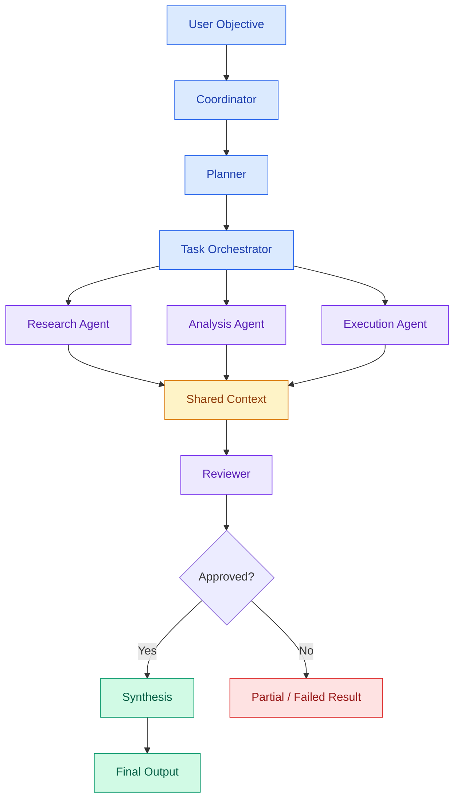

# AgentCrew-AI System Architecture

## 1. Overview

AgentCrew-AI is a modular framework for coordinating
specialized LLM-based agents.

Its architecture separates planning, orchestration,
execution, communication, authorization, and verification.

## 2. Architecture

## 3. Agent Layer

The system defines seven logical roles:

- Coordinator
- Planner
- Researcher
- Executor
- Analyst
- Reviewer
- Synthesizer

All roles implement a common asynchronous execution interface.

## 4. Orchestration Layer

The TaskManager validates proposed task graphs.

The TaskScheduler controls:

- Dependency resolution
- Parallel task execution
- Task state transitions
- Execution timeouts
- Bounded retries
- Failure propagation

A task can execute only after its dependencies succeed.

## 5. Communication Layer

The MessageBus records structured task-assignment and
task-result messages.

The SharedContext provides each agent with its objective,
coordination metadata, and declared dependency results.

## 6. Tool Layer

The ToolRegistry defines callable operations.

The ToolExecutor validates authorization and arguments
before calling registered handlers.

The initial tools are:

- document_search
- calculator

## 7. Security Layer

Security enforcement combines:

1. Trusted agent-role permissions.
2. Registered tool metadata.
3. Application-level authorization context.
4. Tool argument validation.

LLM-generated task descriptions cannot change trusted
tool permissions.

## 8. Verification Layer

The reviewer checks evidence provenance and task requirements.

Unapproved reviews prevent the dependent synthesis task
from executing.

## 9. Observability

The TraceRecorder captures workflow events.

The evaluation module summarizes completion, failures,
blocked tasks, execution duration, and message counts.

## 10. Limitations

The initial implementation uses:

- An in-memory task store.
- An in-memory message bus.
- Local Markdown retrieval.
- A small registered tool set.
- One canonical review-and-synthesis workflow.
- Task retries rather than full automatic replanning.

The mock provider tests system behavior, not LLM reasoning
quality.

The security checks enforce configured tool authorization;
they do not establish comprehensive prompt-injection
resistance.
